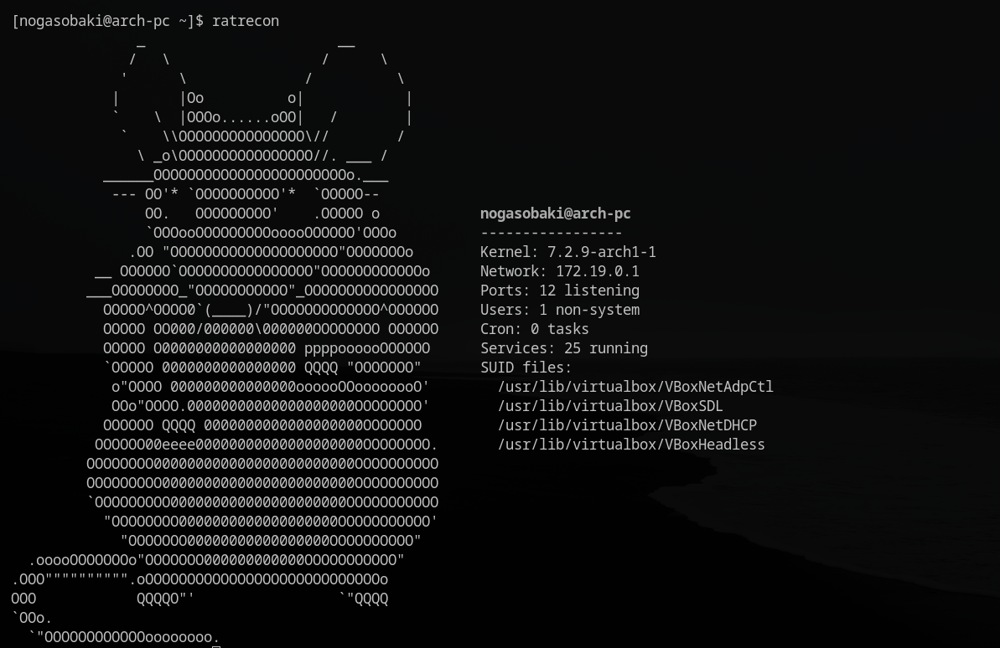

# ratrecon

Лёгкий инструмент разведки системы Linux с выводом ASCII-арта в стиле крысы, вдохновлённый neofetch.

Создан как учебный проект на пути к тестированию на проникновение. Не является заменой таким инструментам, как `linpeas`, но представляет собой персональную утилиту для быстрого обзора системы и демонстрации навыков написания скриптов на Bash.

## Возможности

- Информация о системе: ядро, имя хоста, текущий пользователь
- Сеть: основной IP-адрес
- Количество прослушиваемых портов
- Количество несистемных пользователей
- Количество задач cron
- Количество запущенных сервисов
- SUID-файлы (потенциальные векторы повышения привилегий)

## Скриншот



## Пример вывода

```
               _                       __
              /   \                  /      \
             '      \              /          \
            |       |Oo          o|            |
            `    \  |OOOo......oOO|   /        |
             `    \\OOOOOOOOOOOOOOO\//        /
               \ _o\OOOOOOOOOOOOOOOO//. ___ /
           ______OOOOOOOOOOOOOOOOOOOOOOOo.___
            --- OO'* `OOOOOOOOOO'*  `OOOOO--
                OO.   OOOOOOOOO'    .OOOOO o            nogasobaki@arch-pc
                `OOOooOOOOOOOOOooooOOOOOO'OOOo          -----------------
              .OO "OOOOOOOOOOOOOOOOOOOO"OOOOOOOo        Kernel: 7.2.9-arch1-1
          __ OOOOOO`OOOOOOOOOOOOOOOO"OOOOOOOOOOOOo      Network: 172.19.0.1
         ___OOOOOOOO_"OOOOOOOOOOO"_OOOOOOOOOOOOOOOO     Ports: 10 listening
           OOOOO^OOOO0`(____)/"OOOOOOOOOOOOO^OOOOOO     Users: 1 non-system
           OOOOO OO000/000000\000000OOOOOOOO OOOOOO     Cron: 0 tasks
           OOOOO O0000000000000000 ppppoooooOOOOOO      Services: 25 running
           `OOOOO 0000000000000000 QQQQ "OOOOOOO"       SUID files:
            o"OOOO 000000000000000oooooOOoooooooO'        /usr/lib/virtualbox/VBoxNetAdpCtl
            OOo"OOOO.00000000000000000000OOOOOOOO'        /usr/lib/virtualbox/VBoxSDL
           OOOOOO QQQQ 0000000000000000000OOOOOOO         /usr/lib/virtualbox/VBoxNetDHCP
          OOOOOO00eeee00000000000000000000OOOOOOOO.       /usr/lib/virtualbox/VBoxHeadless
         OOOOOOOO000000000000000000000000OOOOOOOOOO
         OOOOOOOOO00000000000000000000000OOOOOOOOOO
         `OOOOOOOOO000000000000000000000OOOOOOOOOOO
           "OOOOOOOO0000000000000000000OOOOOOOOOOO'
             "OOOOOOO00000000000000000OOOOOOOOOO"
  .ooooOOOOOOOo"OOOOOOO000000000000OOOOOOOOOOO"
.OOO"""""""""".oOOOOOOOOOOOOOOOOOOOOOOOOOOOOo
OOO            QQQQO"'                 `"QQQQ
`OOo.
  `"OOOOOOOOOOOOoooooooo.
```

## Требования

- Linux
- Bash 4+
- Стандартные утилиты: `ip`, `ss`, `awk`, `find`, `systemctl`

## Установка

```bash
git clone https://github.com/nogasobaki1/ratrecon.git
cd ratrecon
chmod +x ratrecon

# Необязательно: добавить в PATH для глобального доступа
echo "export PATH=\"\$PATH:$(pwd)\"" >> ~/.bashrc
source ~/.bashrc
```

## Использование

```bash
./ratrecon
```

Или, если добавлено в PATH:

```bash
ratrecon
```

## Как это работает

Скрипт читает ASCII-арт из `assets/logo.txt` в массив, формирует массив с информацией о системе, затем выводит оба массива рядом с вертикальным центрированием.

## Мотивация

Я создаю этот проект в рамках своего учебного пути к тестированию на проникновение. Мне хотелось сделать собственный проект, поэтому я разработал инструмент, который показывает информацию о системе в чистом и удобочитаемом виде. Тема крысы выбрана не случайно: крыса вынюхивает и собирает информацию - то есть занимается разведкой.

## Примечания

- Сканирование SUID выполняется по всей файловой системе, поэтому первый запуск может занять 10-30 секунд.
- Для полной информации о портах и сервисах запускайте с `sudo`.
- Протестировано на Arch Linux и Kali Linux.

## План развития

- [ ] Добавить флаг `--help`
- [ ] Экспорт отчёта в файл (`--output report.txt`)
- [ ] Параллельное сканирование SUID для ускорения

## Лицензия

MIT - см. [LICENSE](LICENSE)

## Автор

**nogasobaki1** - [GitHub](https://github.com/nogasobaki1)

---

*Этот инструмент предназначен только для образовательных целей и авторизованного тестирования.*


---

[English version / Английская версия](README.md)
